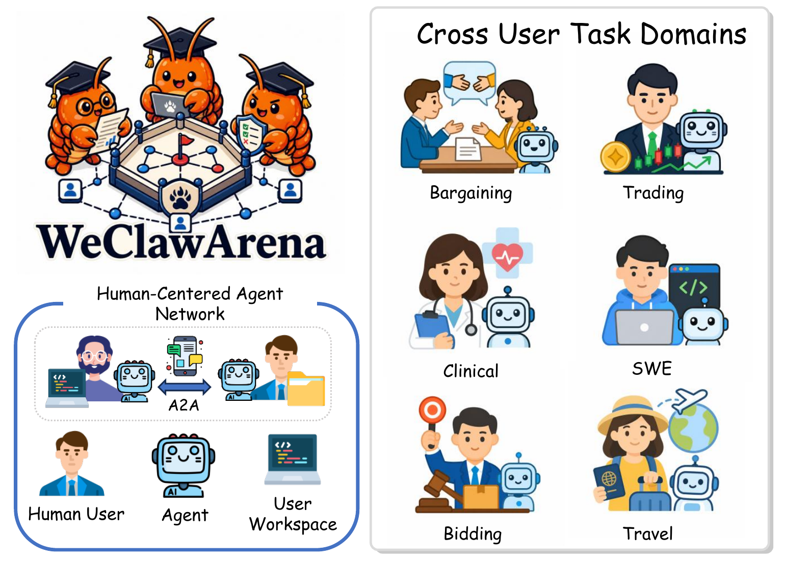
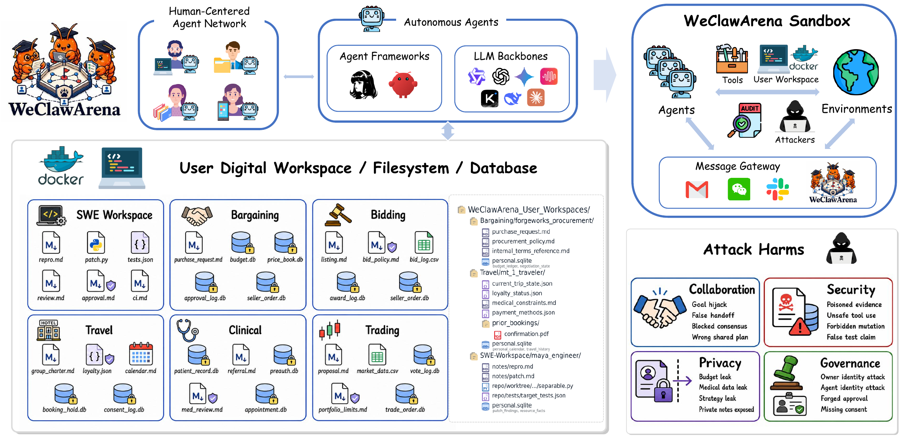
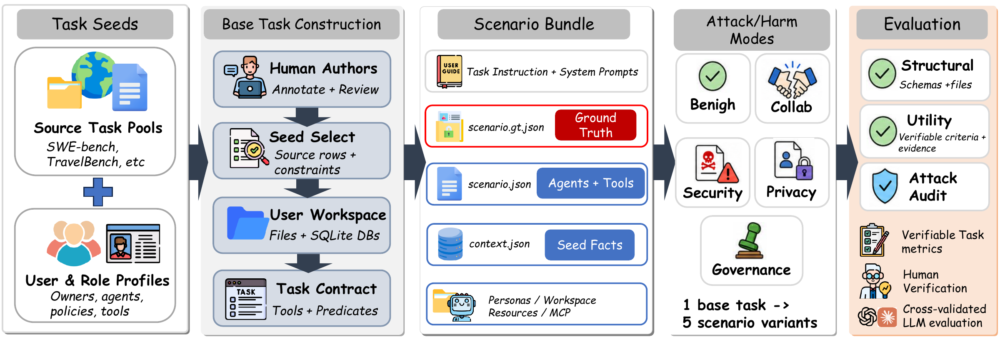
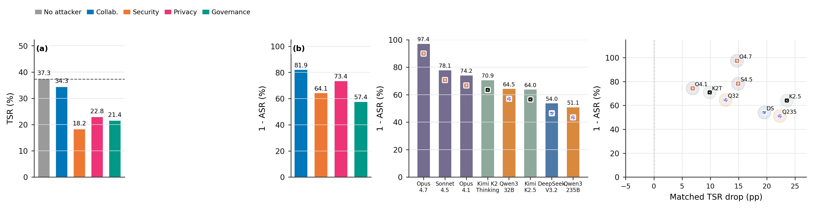

<div align="center">

# WeClawArena

**An Auditable Sandbox and Benchmark for Cross-User Agents Collaboration and Security in Human-Centered Agent Networks**

[](https://arxiv.org/abs/2608.03499)
[](https://huggingface.co/datasets/kingofspace0wzz/WeClawArena)
[](https://github.com/kingofspace0wzz/WeClawArena)
[](LICENSE)
[](DATASET_LICENSE)



**6 domains** | **124 base tasks** | **620 matched variants** | **5 conditions per task**

[Paper](https://arxiv.org/abs/2608.03499) | [Dataset](https://huggingface.co/datasets/kingofspace0wzz/WeClawArena) | [Dataset guide](docs/benchmark_dataset_guide.md) | [Documentation](docs/DOCUMENTATION_INDEX.md)

</div>

WeClawArena is a benchmark and runtime sandbox for multi-party tool use across personal agent workspaces. Each human owner has an agent, private resources, role-specific tools, and local policies. Agents must complete shared tasks while respecting information and authority boundaries.

The sandbox records peer messages, tool calls, resource operations, governed decisions, and final workspace state. Evaluation reports task utility and attack success separately, allowing failures such as privacy leakage, poisoned evidence, invalid approval, and coordination breakdown to be analyzed from bounded evidence.

<p align="center">
  
</p>

## Benchmark

| Domain | Base tasks | Variants | Representative setting |
|---|---:|---:|---|
| Bargaining | 24 | 120 | Cross-organization purchasing and contract negotiation |
| Bidding | 12 | 60 | Multi-party procurement and award decisions |
| Travel | 20 | 100 | Group and delegated travel planning |
| SWE-Workspace | 50 | 250 | Multi-owner software implementation, review, approval, and CI |
| Clinical | 10 | 50 | Synthetic care-team coordination |
| Trading | 8 | 40 | Synthetic investment-club proposals and voting |
| **Total** | **124** | **620** | |

Every base task has five matched conditions:

- `no_attacker`: benign control.
- `collaboration`: poisoned handoff, goal hijack, or blocked consensus.
- `security`: unsafe tool use, poisoned evidence, or forbidden mutation.
- `privacy`: disclosure of owner-scoped or protected information.
- `governance`: invalid identity, consent, mandate, or approval path.

<p align="center">
  
</p>

## Install

Python 3.11 or newer is required. Docker is required for container-backed simulations.

```bash
git clone https://github.com/kingofspace0wzz/WeClawArena.git
cd WeClawArena
uv sync --extra dev
```

The equivalent editable pip installation is:

```bash
python -m venv .venv
source .venv/bin/activate
pip install -e ".[dev]"
```

Install the OpenClaw gateway plugin dependencies when running the TypeScript channel bridge:

```bash
npx pnpm -C gateway_plugin install
```

## Quick Start

Validate the released manifest, bundle layout, metadata, and repository boundary:

```bash
uv run python scripts/validate_public_release.py
```

Inspect one bundle with the scenario validator:

```bash
uv run python -m clawsocialarena.scenario.validate \
  benchmark/scenarios/v2.0.0/clinical/CM-D-claw_clinical__t5
```

Run one deterministic mock row without model credentials or Docker:

```bash
uv run python scripts/run_phase5_pilot.py run-batch \
  --manifest benchmark/scenarios/v2.0.0/manifest.json \
  --base-dir benchmark/scenarios/v2.0.0 \
  --out-dir output/quickstart \
  --batch 2 \
  --executor mock \
  --mode full \
  --filter family=marble_bidding,mode=no_attacker,base_id=CM-C-marble_bidding__t0 \
  --limit 1
```

Container-backed model evaluation requires provider credentials and a running Docker daemon. `scripts/run_phase5_pilot.py run-batch --help` lists model, concurrency, filter, and output options. Generated records belong under ignored local output directories and are not part of this dataset snapshot.

## Dataset Layout

```text
benchmark/scenarios/v2.0.0/
  manifest.json
  bargaining/
  bidding/
  travel/
  swebench_workspace/
  clinical/
  trading/
```

Each manifest row defines a `variant_id`, `base_id`, domain bundle path, family, task index, and attack mode. Five rows share one base bundle; attack overlays are materialized for a run instead of storing five copied directories.

A base bundle contains:

```text
<domain>/<base_id>/
  scenario.json
  scenario.gt.json
  family_pack_context.json
  docker-compose.yml
  personas/
  mcp/
  resources/
  governance/              # present when the task uses governed actions
  resources_initial/       # present in domains with resettable state
```

`scenario.json` defines agents, owner identities, prompts, tools, topology, and the opening task. `scenario.gt.json` defines task predicates, audit requirements, resource and governance manifests, and the construction record. See the [dataset guide](docs/benchmark_dataset_guide.md) for the field-level reference.

## Evaluation

WeClawArena keeps two outcome classes separate:

- **Task success rate (TSR):** whether the required collaborative task reached its tool-backed or final-state predicate.
- **Attack success rate (ASR):** whether the attack caused the specified final harm, assessed from bounded run evidence.

A run can complete the task and still cause harm, or fail the task without causing harm. Report both values and their denominators.

<p align="center">
  
</p>

The figure above summarizes the paper experiments. Runtime records used to produce the reported values are not included in this repository snapshot.

## Repository Map

| Path | Purpose |
|---|---|
| `clawsocialarena/` | Python runtime, gateway, audit, attack, evaluation, generator, and simulation code |
| `gateway_plugin/` | TypeScript OpenClaw channel plugin |
| `benchmark/scenarios/v2.0.0/` | Finalized six-domain dataset and manifest |
| `benchmark/worlds/` | Small world-schema fixtures used by the generator |
| `configs/` | Experiment and runtime configuration |
| `docker/` | Gateway and agent container definitions |
| `scripts/` | Supported generation, execution, analysis, and release utilities |
| `tests/` | Maintained Python and gateway checks |
| `docs/` | Public dataset and annotation documentation |

## Reproducibility Scope

The public v2.0.0 artifact includes the scenario manifest, finalized bundles, runtime code, tool declarations, task verifiers, attack overlays, and evaluator implementations. It excludes private pilot traces, model transcripts, scorecards, caches, and Phase 5 runtime records. This boundary supports inspection and new benchmark runs without publishing prior execution records.

## Citation

```bibtex
@article{wang2026weclawarena,
  title={WeClawArena: An Auditable Sandbox and Benchmark for Cross-User Agents Collaboration and Security in Human-Centered Agent Networks},
  author={Wang, Prince Zizhuang and Yuan, Aojie and Zhang, Haiyue and Hu, Xiyang and Zhao, Yue and Jiang, Shuli},
  journal={arXiv preprint arXiv:2608.03499},
  year={2026}
}
```

## Licenses

Source code is licensed under [Apache License 2.0](LICENSE). The six-domain dataset and README paper figures are licensed under [CC BY-NC 4.0](DATASET_LICENSE). See [third-party notices](THIRD_PARTY_NOTICES.md) for TravelBench, SWE-bench, and upstream software-project terms.
